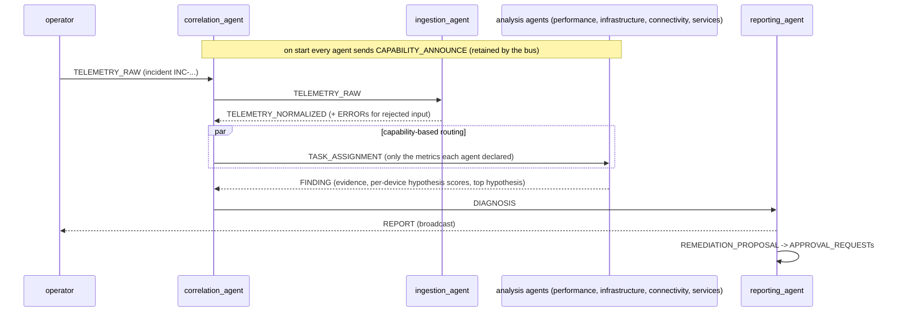
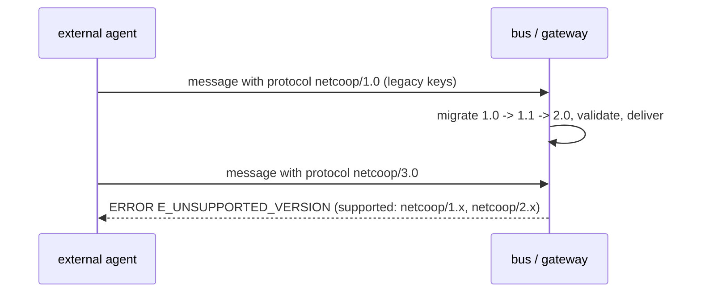
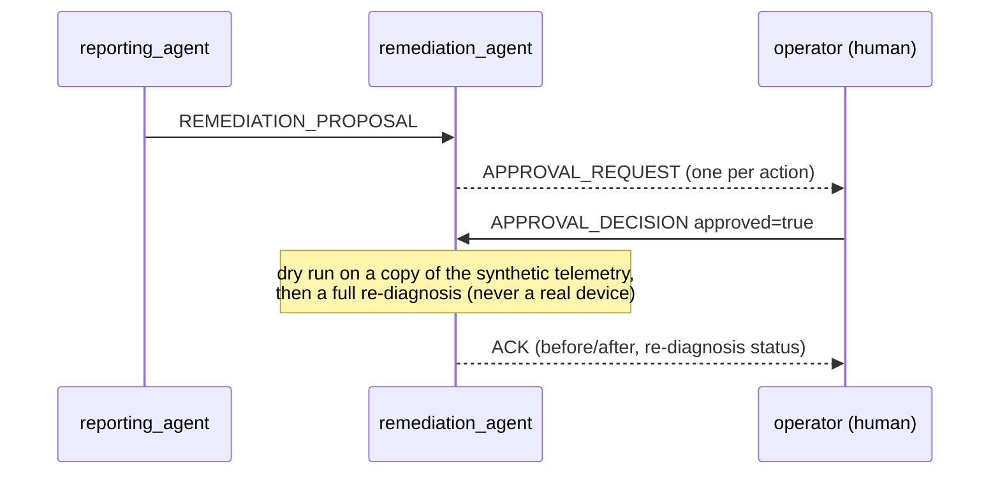

# NetCoop protocol `netcoop/2.0`

> Generated by `python -m netcoop.protocol.protocol_doc` from the Pydantic models in `netcoop/protocol/`.
> Do not edit the tables by hand: change the models and regenerate. Machine-readable JSON Schemas are in
> [`schemas/`](schemas/) (`message.schema.json` is the discriminated union of every message).

## 1. Overview

Agents never call each other. Every interaction is a JSON **message** on the bus: an **envelope** (who, to whom,
which conversation, which version) around a **typed payload** (one schema per message type). The in-process bus
serialises every message to JSON and each recipient decodes and validates its own copy, which is the same path an
external agent uses through the REST gateway. Every metric value carries an explicit **unit** from a canonical
vocabulary, every evidence item carries its **quality** and **source agent**, and every failure is a structured
`ERROR` with a code from the table in section 6.

### Envelope fields and FIPA ACL

The envelope deliberately mirrors the FIPA ACL message parameters (FIPA SC00061G):

| NetCoop envelope | FIPA ACL parameter | Meaning |
|---|---|---|
| `type` | performative | What the message does (FINDING, QUERY, ...) |
| `from_agent` / `to_agent` | sender / receiver | `to_agent="broadcast"` = every subscriber of that type |
| `correlation_id` | conversation-id | The incident id; ties all messages of one incident together |
| `causation_id` | in-reply-to | `msg_id` of the message that caused this one (used for sequence diagrams) |
| `payload_schema` | ontology | Name and version of the payload schema, e.g. `finding/1.0` |
| `protocol` | protocol | `netcoop/<major>.<minor>` |
| `ttl_s` | reply-by (relative) | Seconds after `timestamp` the message stays deliverable |

### Message types

| Type | Purpose |
|---|---|
| `TASK_ASSIGNMENT` | Analysis task with only the metrics the receiver declared (correlator -> analysis agent); kind=resume_incident continues a paused incident |
| `TELEMETRY_RAW` | Raw telemetry as received (client -> correlator -> ingestion agent) |
| `TELEMETRY_NORMALIZED` | Canonical v2 records + ingestion report (ingestion -> correlator) |
| `FINDING` | Evidence and per-device hypothesis scores (analysis agent -> correlator) |
| `QUERY` | Challenge-round question about one premise (correlator -> owning agent) |
| `RESPONSE` | Answer with evidence; answer=null means 'cannot tell' (agent -> correlator) |
| `DIAGNOSIS` | Decision, confidence breakdown, alternatives (correlator -> reporting agent) |
| `REPORT` | Final report, organizer-compatible (reporting agent -> broadcast) |
| `ERROR` | Structured failure with an error code; always broadcast |
| `ACK` | Acknowledgement, e.g. 'paused after ingestion' or a simulation summary |
| `HEARTBEAT` | Liveness and state (starting/ready/busy/stopping) |
| `CAPABILITY_ANNOUNCE` | What an agent consumes, produces, judges and answers; retained by the bus |
| `REMEDIATION_PROPOSAL` | Ranked actions for human review (reporting -> remediation agent) |
| `APPROVAL_REQUEST` | One action awaiting a human decision (remediation agent -> broadcast) |
| `APPROVAL_DECISION` | Human approve/reject (operator -> remediation agent) |

## 2. Field tables

Generated from the models. Units: `see unit` means the item's own `unit` field applies; `0..1` marks fractions and probabilities.

### Envelope

| Field | Type | Required | Unit | Meaning |
|---|---|---|---|---|
| `protocol` | string | no |  | family/major.minor |
| `msg_id` | string | no |  | UUID4, unique per message |
| `correlation_id` | string | yes |  | Incident id; ties all messages of one incident together |
| `causation_id` | string \| null | no |  | msg_id of the message that caused this one |
| `from_agent` | string | yes |  |  |
| `to_agent` | string | no |  | Agent name, or 'broadcast' |
| `type` | MessageType | yes |  |  |
| `timestamp` | datetime (ISO-8601 UTC) | no |  | ISO-8601 UTC |
| `ttl_s` | integer | no | s | Seconds after `timestamp` the message stays deliverable |
| `payload_schema` | string | yes |  | Payload schema name/version, e.g. 'finding/1.0' |
| `payload` | any | yes |  |  |

### TASK_ASSIGNMENT (`task_assignment/1.0`)

| Field | Type | Required | Unit | Meaning |
|---|---|---|---|---|
| `task_id` | string | yes |  | Identifier of the task this message belongs to |
| `kind` | analyze_telemetry \| resume_incident | no |  |  |
| `deadline_s` | number | yes | s | Seconds the agent has to reply with a FINDING |
| `records` | list[TelemetryRecord] | yes |  | Only the metrics this agent declared it consumes |
| `metrics_of_interest` | list[string] | no |  |  |
| `context` | map[str, any] | no |  |  |

### TELEMETRY_RAW (`telemetry_raw/1.0`)

| Field | Type | Required | Unit | Meaning |
|---|---|---|---|---|
| `source` | string | no |  | File name, 'inline' or 'gateway' |
| `content_type` | auto \| json \| jsonl \| csv | no |  | auto / json / jsonl / csv |
| `content` | string | yes |  | Raw text exactly as received |

### TELEMETRY_NORMALIZED (`telemetry_normalized/1.0`)

| Field | Type | Required | Unit | Meaning |
|---|---|---|---|---|
| `records` | list[TelemetryRecord] | yes |  | Telemetry records |
| `report` | IngestionReport | yes |  | The diagnostic report |

### FINDING (`finding/1.0`)

| Field | Type | Required | Unit | Meaning |
|---|---|---|---|---|
| `task_id` | string | yes |  | Identifier of the task this message belongs to |
| `agent` | string | yes |  | Name of the agent |
| `agent_version` | string | no |  | Semantic version of the agent |
| `hypothesis_scores` | list[HypothesisScore] | no |  | Per-device contributions to each hypothesis (see HypothesisScore) |
| `top_hypothesis` | Hypothesis \| null | no |  | The agent's own best explanation; null = no opinion |
| `evidence` | list[EvidenceItem] | no |  | Evidence items (see EvidenceItem) |
| `devices_flagged` | list[string] | no |  | Devices with at least one abnormal signal |
| `metrics_analyzed` | list[string] | no |  | Canonical metrics the agent looked at |
| `metrics_missing` | list[string] | no |  | Declared inputs absent in the batch |
| `data_coverage` | number | no | 0..1 | Share of expected data that was usable |
| `claims` | list[Claim] | no |  | Machine-checkable assertions used for contradiction detection |
| `localization` | Localization \| null | no |  | Root vs symptomatic devices (connectivity agent) |
| `limitations` | list[string] | no |  | Caveats the reader must know |

### QUERY (`query/1.0`)

| Field | Type | Required | Unit | Meaning |
|---|---|---|---|---|
| `query_id` | string | yes |  | Identifier echoed by the RESPONSE |
| `round` | integer | no |  | Challenge round number |
| `question` | string | yes |  | Human-readable form of the question |
| `predicate` | QueryPredicate | yes |  | Machine-readable question type |
| `params` | map[str, string \| number \| integer \| boolean \| null] | no |  | Predicate arguments (device_id, metric, ...) |
| `hypotheses_at_stake` | list[Hypothesis] | no |  | Hypotheses the answer can separate |

### RESPONSE (`response/1.0`)

| Field | Type | Required | Unit | Meaning |
|---|---|---|---|---|
| `query_id` | string | yes |  | Identifier echoed by the RESPONSE |
| `answer` | boolean \| null | no |  | null = cannot tell from available data |
| `value` | number \| null | no |  | Observed value |
| `unit` | Unit \| null | no |  | Canonical unit of value |
| `explanation` | string | no |  | Human-readable justification |
| `evidence` | list[EvidenceItem] | no |  | Evidence items (see EvidenceItem) |
| `supports` | list[Hypothesis] | no |  | Hypotheses this answer supports |
| `refutes` | list[Hypothesis] | no |  | Hypotheses this answer refutes |

### DIAGNOSIS (`diagnosis/1.0`)

| Field | Type | Required | Unit | Meaning |
|---|---|---|---|---|
| `status` | DiagnosisStatus | yes |  | Outcome status |
| `root_cause_code` | Hypothesis \| null | no |  | Hypothesis code of the root cause |
| `confidence` | number | no | 0..1 | Calibrated confidence = P(top) x coverage x agreement |
| `confidence_category` | ConfidenceCategory | no |  | high / medium / low |
| `probabilities` | map[str, number] | no |  | Softmax probability per hypothesis |
| `root_device` | string \| null | no |  | Device where the root cause sits |
| `affected_devices` | list[string] | no |  | Root plus symptomatic devices |
| `symptomatic_devices` | list[string] | no |  | Devices showing symptoms that the root cause explains |
| `affected_segments` | list[string] | no |  | Zones of the affected devices |
| `supporting_evidence` | list[EvidenceItem] | no |  | Evidence for the root cause |
| `contradicting_evidence` | list[EvidenceItem] | no |  | Evidence against it |
| `alternative_causes` | list[AlternativeCause] | no |  | Ranked alternatives with probabilities and why they are less likely |
| `agent_findings_summary` | list[AgentFindingSummary] | no |  | Each agent's top hypothesis and whether it responded |
| `conflict_resolution` | ConflictResolution | no |  | Whether agents disagreed and how the challenge round resolved it |
| `data_quality` | DataQuality | no |  | Ingestion coverage, conversions, rejections, warnings |
| `confidence_breakdown` | ConfidenceBreakdown | no |  | Factors of the confidence formula |
| `secondary_incidents` | list[SecondaryIncident] | no |  | Independent faults outside the primary root's subtree |
| `next_data_to_collect` | list[string] | no |  | Data that would confirm or rule out the leading candidates |
| `evidence_sources` | list[string] | no |  | Agents whose evidence contributed |
| `limitations` | list[string] | no |  | Caveats the reader must know |

### REPORT (`report/1.0`)

| Field | Type | Required | Unit | Meaning |
|---|---|---|---|---|
| `report` | DiagnosticReport | yes |  | The diagnostic report |
| `json_path` | string \| null | no |  | Where the JSON report was written |
| `markdown_path` | string \| null | no |  | Where the Markdown report was written |

### ERROR (`error/1.0`)

| Field | Type | Required | Unit | Meaning |
|---|---|---|---|---|
| `code` | ErrorCode | yes |  | Error code (see error table) |
| `message` | string | yes |  | Human-readable error |
| `detail` | map[str, string \| number \| integer \| boolean \| null] | no |  | Structured details |
| `offending_msg_id` | string \| null | no |  | msg_id of the message that caused the error |
| `recoverable` | boolean | no |  | Whether processing continued |

### ACK (`ack/1.0`)

| Field | Type | Required | Unit | Meaning |
|---|---|---|---|---|
| `acked_msg_id` | string | yes |  | msg_id being acknowledged |
| `note` | string | no |  | Free-text outcome |

### HEARTBEAT (`heartbeat/1.0`)

| Field | Type | Required | Unit | Meaning |
|---|---|---|---|---|
| `agent` | string | yes |  | Name of the agent |
| `version` | string | yes |  | Semantic version of the agent |
| `state` | starting \| ready \| busy \| stopping | no |  | Lifecycle state |
| `uptime_s` | number | no | s | Seconds since the agent started |

### CAPABILITY_ANNOUNCE (`capability_announce/1.0`)

| Field | Type | Required | Unit | Meaning |
|---|---|---|---|---|
| `agent` | string | yes |  | Name of the agent |
| `version` | string | yes |  | Semantic version of the agent |
| `description` | string | no |  | Human-readable description |
| `supported_protocols` | list[string] | no |  | Protocol versions the agent reads |
| `consumes` | list[MessageType] | no |  | Message types it consumes |
| `produces` | list[MessageType] | no |  | Message types it produces |
| `inputs` | list[string] | no |  | Canonical metrics it needs in TASK_ASSIGNMENTs |
| `metrics` | list[string] | no |  | Metrics/signals it judges and answers QUERYs on |
| `hypotheses` | list[Hypothesis] | no |  | Hypotheses it can score |
| `query_predicates` | list[QueryPredicate] | no |  | QUERY types it answers |
| `skills` | list[Skill] | no |  | A2A-style skills (for Agent Cards) |

### REMEDIATION_PROPOSAL (`remediation_proposal/1.0`)

| Field | Type | Required | Unit | Meaning |
|---|---|---|---|---|
| `incident_id` | string | yes |  | Incident identifier |
| `actions` | list[RecommendedAction] | yes |  | Proposed actions |

### APPROVAL_REQUEST (`approval_request/1.0`)

| Field | Type | Required | Unit | Meaning |
|---|---|---|---|---|
| `incident_id` | string | yes |  | Incident identifier |
| `action_id` | string | yes |  | Identifier of the action |
| `action` | string | yes |  | What to do |
| `risk` | low \| medium \| high | no |  | low / medium / high |
| `requested_from` | string | no |  | Who must decide |

### APPROVAL_DECISION (`approval_decision/1.0`)

| Field | Type | Required | Unit | Meaning |
|---|---|---|---|---|
| `incident_id` | string | yes |  | Incident identifier |
| `action_id` | string | yes |  | Identifier of the action |
| `approved` | boolean | yes |  | Human decision |
| `decided_by` | string | no |  | Who decided |
| `reason` | string | no |  | Why |
| `simulated_result` | string \| null | no |  | Outcome of the dry-run simulation |

### Nested types

#### TelemetryRecord

| Field | Type | Required | Unit | Meaning |
|---|---|---|---|---|
| `device_id` | string | yes |  | Device identifier |
| `timestamp` | datetime (ISO-8601 UTC) | yes |  | Time of the observation (UTC) |
| `status` | DeviceStatus | no |  | Outcome status |
| `status_original` | string \| null | no |  | Status string as supplied (e.g. 'Critical') |
| `metrics` | map[str, MetricValue] | no |  | Keyed by canonical metric name |
| `unmapped` | map[str, string \| number \| integer \| boolean \| null] | no |  | Fields we could not map |
| `source_format` | string | no |  | organizer_v1 \| canonical_v2 \| legacy_v1_1 \| csv |
| `record_quality` | Quality | no |  |  |

#### MetricValue

| Field | Type | Required | Unit | Meaning |
|---|---|---|---|---|
| `value` | number \| null | no |  | Canonical value; null when missing or rejected |
| `unit` | Unit | yes |  | Canonical unit (see vocabulary) |
| `quality` | Quality | no |  | ok / converted / imputed / missing / stale / ... |
| `provenance` | list[Provenance] | no |  |  |

#### Provenance

| Field | Type | Required | Unit | Meaning |
|---|---|---|---|---|
| `original_field` | string \| null | no |  | Field name as it appeared in the input |
| `original_value` | string \| number \| integer \| boolean \| null | no |  | Value as it appeared in the input |
| `original_unit` | string \| null | no |  | Unit of the original value, if known |
| `method` | MappingMethod | no |  | How the canonical value was obtained |
| `note` | string \| null | no |  | Free-text outcome |

#### IngestionReport

| Field | Type | Required | Unit | Meaning |
|---|---|---|---|---|
| `records_in` | integer | no |  |  |
| `records_accepted` | integer | no |  |  |
| `records_rejected` | integer | no |  |  |
| `formats_detected` | list[string] | no |  |  |
| `schema_versions` | list[string] | no |  |  |
| `conversions` | list[ConversionNote] | no |  |  |
| `rejections` | list[RejectionNote] | no |  |  |
| `unmapped_fields` | list[string] | no |  |  |
| `warnings` | list[string] | no |  |  |
| `quality_counts` | map[str, integer] | no |  |  |
| `data_coverage` | number | no | 0..1 | Share of usable metric values among those expected |
| `fatal` | boolean | no |  | True if no usable record survived ingestion |

#### ConversionNote

| Field | Type | Required | Unit | Meaning |
|---|---|---|---|---|
| `record_index` | integer \| null | no |  |  |
| `device_id` | string \| null | no |  | Device identifier |
| `original_field` | string | yes |  |  |
| `canonical_field` | string | yes |  |  |
| `method` | MappingMethod | yes |  | How the confidence was computed |
| `from_value` | string \| number \| integer \| boolean \| null | no |  |  |
| `to_value` | string \| number \| integer \| boolean \| null | no |  |  |
| `from_unit` | string \| null | no |  |  |
| `to_unit` | string \| null | no |  |  |
| `note` | string \| null | no |  | Free-text outcome |
| `count` | integer | no |  | Identical conversions are aggregated; this is how many |

#### RejectionNote

| Field | Type | Required | Unit | Meaning |
|---|---|---|---|---|
| `record_index` | integer \| null | no |  |  |
| `device_id` | string \| null | no |  | Device identifier |
| `field` | string \| null | no |  |  |
| `code` | ErrorCode | yes |  | Error code (see error table) |
| `reason` | string | yes |  | Why |
| `record_rejected` | boolean | no |  | True if the whole record was dropped |

#### EvidenceItem

| Field | Type | Required | Unit | Meaning |
|---|---|---|---|---|
| `metric` | string | yes |  | Canonical metric name, or a derived signal such as 'topology' |
| `value` | number \| null | no | see `unit` | Observed value |
| `unit` | Unit \| null | no |  | Canonical unit of value |
| `device_id` | string \| null | no |  | Device identifier |
| `threshold` | number \| null | no | see `unit` | Threshold the value was compared against (same unit) |
| `severity` | number | no | 0..1 | 0 = at/below warn, 1 = at/beyond crit (piecewise linear) |
| `direction` | Direction | no |  | above = higher is worse |
| `interpretation` | string | yes |  | Human-readable meaning |
| `quality` | Quality | no |  | ok / converted / imputed / missing / stale / ... |
| `source_agent` | string | no |  | Agent that produced the item |
| `timestamp` | datetime (ISO-8601 UTC) \| null | no |  | Time of the observation (UTC) |
| `z_score` | number \| null | no |  | Robust deviation from the device's own baseline (series only) |
| `basis` | threshold \| baseline | no |  | 'baseline' = below the fixed threshold but abnormal versus the device's history |

#### HypothesisScore

| Field | Type | Required | Unit | Meaning |
|---|---|---|---|---|
| `hypothesis` | Hypothesis | yes |  | Hypothesis code |
| `device_id` | string \| null | no |  | Device the score refers to; null = incident-wide |
| `raw` | number | no |  | Unnormalized weighted evidence sum from this agent |
| `score` | number | no |  | Agent-local normalized score |
| `rationale` | string | no |  | Why |

#### Localization

| Field | Type | Required | Unit | Meaning |
|---|---|---|---|---|
| `root_device` | string \| null | no |  | Device where the root cause sits |
| `symptomatic_devices` | list[string] | no |  | Devices showing symptoms that the root cause explains |
| `affected_devices` | list[string] | no |  | Root plus symptomatic devices |
| `affected_segments` | list[string] | no |  | Zones of the affected devices |
| `partitioned_devices` | list[string] | no |  |  |
| `method` | string | no |  | How the confidence was computed |

#### AlternativeCause

| Field | Type | Required | Unit | Meaning |
|---|---|---|---|---|
| `cause` | Hypothesis | yes |  | Alternative hypothesis |
| `description` | string | no |  | Human-readable description |
| `probability` | number | yes | 0..1 | Softmax probability |
| `why_less_likely` | string | no |  | Score gap, contradicting rules, healthy or missing key signals |

#### RecommendedAction

| Field | Type | Required | Unit | Meaning |
|---|---|---|---|---|
| `action_id` | string | yes |  | Identifier of the action |
| `action` | string | yes |  | What to do |
| `hypothesis` | Hypothesis \| null | no |  | Hypothesis code |
| `priority` | integer | no |  | 1 = do first |
| `risk` | low \| medium \| high | no |  | low / medium / high |
| `safe_to_simulate` | boolean | no |  | Has a dry-run effect |
| `requires_approval` | boolean | no |  | Always true |
| `target_device` | string \| null | no |  | Device the action applies to |
| `simulated_result` | string \| null | no |  | Outcome of the dry-run simulation |

#### ConfidenceBreakdown

| Field | Type | Required | Unit | Meaning |
|---|---|---|---|---|
| `p_top` | number | no | 0..1 | Probability of the top hypothesis |
| `p_second` | number | no | 0..1 | Probability of the runner-up |
| `margin` | number | no |  | p_top - p_second |
| `data_coverage` | number | no | 0..1 | Share of expected data that was usable |
| `agreement_factor` | number | no | 0..1 | Share of eligible agents agreeing (resolved dissent counts partially) |
| `combiner` | string | no |  | Evidence combination method |
| `unknown_mass` | number \| null | no | 0..1 | Dempster-Shafer combiner only |
| `method` | string | no |  | How the confidence was computed |

#### ConflictResolution

| Field | Type | Required | Unit | Meaning |
|---|---|---|---|---|
| `conflict_detected` | boolean | no |  |  |
| `reasons` | list[string] | no |  |  |
| `rounds` | integer | no |  |  |
| `queries` | list[string] | no |  |  |
| `resolution` | string | no |  |  |

#### DataQuality

| Field | Type | Required | Unit | Meaning |
|---|---|---|---|---|
| `coverage` | number | no | 0..1 |  |
| `records_in` | integer | no |  |  |
| `conversions` | integer | no |  |  |
| `rejected_records` | integer | no |  |  |
| `unmapped_fields` | list[string] | no |  |  |
| `warnings` | list[string] | no |  |  |

#### DiagnosticReport

| Field | Type | Required | Unit | Meaning |
|---|---|---|---|---|
| `incident_id` | string | yes |  | Incident identifier |
| `status` | DiagnosisStatus | yes |  | Outcome status |
| `suspected_root_cause` | string | yes |  | Human-readable root cause statement |
| `root_cause_code` | Hypothesis \| null | no |  | Hypothesis code of the root cause |
| `confidence` | number | yes | 0..1 | Calibrated confidence = P(top) x coverage x agreement |
| `confidence_category` | ConfidenceCategory | yes |  | high / medium / low |
| `affected_devices` | list[string] | no |  | Root plus symptomatic devices |
| `root_device` | string \| null | no |  | Device where the root cause sits |
| `symptomatic_devices` | list[string] | no |  | Devices showing symptoms that the root cause explains |
| `affected_segments` | list[string] | no |  | Zones of the affected devices |
| `supporting_evidence` | list[EvidenceItem] | no |  | Evidence for the root cause |
| `contradicting_evidence` | list[EvidenceItem] | no |  | Evidence against it |
| `alternative_causes` | list[AlternativeCause] | no |  | Ranked alternatives with probabilities and why they are less likely |
| `recommended_actions` | list[RecommendedAction] | no |  | Ranked actions (human approval required; simulated only) |
| `evidence_sources` | list[string] | no |  | Agents whose evidence contributed |
| `agent_findings_summary` | list[AgentFindingSummary] | no |  | Each agent's top hypothesis and whether it responded |
| `conflict_resolution` | ConflictResolution | no |  | Whether agents disagreed and how the challenge round resolved it |
| `data_quality` | DataQuality | no |  | Ingestion coverage, conversions, rejections, warnings |
| `confidence_breakdown` | ConfidenceBreakdown | no |  | Factors of the confidence formula |
| `secondary_incidents` | list[SecondaryIncident] | no |  | Independent faults outside the primary root's subtree |
| `next_data_to_collect` | list[string] | no |  | Data that would confirm or rule out the leading candidates |
| `limitations` | list[string] | no |  | Caveats the reader must know |
| `narrative` | string | no |  | Prose summary (template, or LLM when enabled) |
| `protocol_version` | string | no |  | Protocol of the report |
| `generated_at` | datetime (ISO-8601 UTC) | no |  | Report creation time (UTC) |
| `message_log` | string \| null | no |  | Path of the incident's JSONL message log |

#### Skill

| Field | Type | Required | Unit | Meaning |
|---|---|---|---|---|
| `id` | string | yes |  |  |
| `name` | string | yes |  |  |
| `description` | string | no |  | Human-readable description |
| `tags` | list[string] | no |  |  |


## 3. Sequence diagrams

### 3.1 Normal run



### 3.2 Challenge round (conflict resolution)

```mermaid
sequenceDiagram
    participant C as correlation_agent
    participant P as performance_agent
    participant F as infrastructure_agent
    participant N as connectivity_agent
    P-->>C: FINDING top=link_congestion
    F-->>C: FINDING top=hardware_failure
    Note over C: conflict: agents disagree, or top-2 scores within conflict_margin
    C->>F: QUERY metric_above_threshold(interface_errors, SW_CAMPUS_4)
    C->>P: QUERY metric_above_threshold(packet_loss_pct, SW_CAMPUS_4)
    C->>N: QUERY fault_localization(SW_CAMPUS_4)
    F-->>C: RESPONSE answer=true, evidence 382 errors (critical)
    P-->>C: RESPONSE answer=true, evidence 28.5 % loss
    N-->>C: RESPONSE answer=false (neighbours healthy: fault is local)
    Note over C: premises confirmed -> rule interface_errors_beat_congestion fires;<br/>re-score, at most max_challenge_rounds rounds
```

### 3.3 Agent timeout or crash

```mermaid
sequenceDiagram
    participant C as correlation_agent
    participant P as performance_agent
    participant F as infrastructure_agent
    C->>P: TASK_ASSIGNMENT
    C->>F: TASK_ASSIGNMENT
    F-->>C: ERROR E_INTERNAL (agent crashed, causation_id = task)
    Note over P: no FINDING within agent_timeout_s
    C-->>C: ERROR E_AGENT_TIMEOUT (logged, broadcast)
    Note over C: diagnose on the remaining evidence;<br/>missing agents listed in limitations, agreement and coverage drop
```

### 3.4 Version mismatch



### 3.5 Human-in-the-loop remediation (simulation only)



## 4. Versioning policy

* **Version string** `netcoop/<major>.<minor>` in every envelope; every payload names its own `payload_schema`
  (`<name>/<major>.<minor>`).
* **Minor versions are fully compatible** (backward and forward, in the Confluent Schema Registry sense): a minor
  release may only *add optional fields*. Receivers apply a **must-ignore** rule to fields they do not know, so a
  `netcoop/2.7` message validates as `2.0` and a `2.0` message is accepted by a `2.7` agent.
* **Major versions require a migration** in `netcoop/protocol/migrations.py`. Majors 1 and 2 are readable today:
  1.0 -> 1.1 (epoch `ts` becomes ISO-8601, `in_reply_to` and `ttl` added) -> 2.0 (FIPA-style field names,
  explicit `payload_schema`, typed payloads, explicit units on evidence). Any other major is answered with
  `E_UNSUPPORTED_VERSION`; it is never dropped silently.
* Every agent states the versions it reads in `CAPABILITY_ANNOUNCE.supported_protocols`.
* **Telemetry input** has its own versions (organizer v1, legacy v1.0/v1.1, canonical v2); the ingestion agent
  migrates all of them field by field and records each change in the ingestion report.

## 5. Vocabulary

### 5.1 Metrics and units

Canonical names follow OpenTelemetry-style naming; units are given in short form and as UCUM codes.

| Metric | Unit | UCUM | Domain | Warn / crit | Meaning |
|---|---|---|---|---|---|
| `latency_ms` | ms | `ms` | performance | 50 / 150 | Round-trip latency (ICMP) to the gateway/core |
| `jitter_ms` | ms | `ms` | performance | 20 / 50 | Variation in round-trip latency |
| `packet_loss_pct` | % | `%` | performance | 0.1 / 1 | Share of probe packets lost |
| `throughput_mbps` | Mbps | `Mbit/s` | performance | - | Measured goodput on the uplink |
| `bandwidth_mbps` | Mbps | `Mbit/s` | performance | - | Provisioned link capacity |
| `link_utilization_pct` | % | `%` | performance | 70 / 90 | Uplink utilization relative to capacity |
| `retransmission_pct` | % | `%` | wireless | 10 / 25 | Share of frames retransmitted (Wi-Fi/TCP) |
| `wifi_rssi_dbm` | dBm | `dB[mW]` | wireless | -67 / -75 (lower is worse) | Received signal strength at the client/AP |
| `wifi_snr_db` | dB | `dB` | wireless | 25 / 15 (lower is worse) | Signal-to-noise ratio |
| `cpu_utilization_pct` | % | `%` | infrastructure | 75 / 90 | Device CPU utilization |
| `memory_utilization_pct` | % | `%` | infrastructure | 80 / 95 | Device memory utilization |
| `queue_drops` | count | `{count}` | infrastructure | 100 / 1000 | Egress queue drops in the sample interval |
| `interface_errors` | count | `{count}` | infrastructure | 10 / 100 | Interface input/CRC errors in the sample interval |
| `interface_flaps` | count | `{count}` | infrastructure | 1 / 3 | Link up/down transitions in the sample interval |
| `uptime_s` | s | `s` | infrastructure | - | Device uptime (a drop indicates a reboot) |
| `dns_success_pct` | % | `%` | service | 99 / 90 (lower is worse) | Share of DNS probe queries resolved |
| `dns_latency_ms` | ms | `ms` | service | 100 / 500 | DNS resolution time |
| `dhcp_success_pct` | % | `%` | service | 98 / 90 (lower is worse) | Share of DHCP lease attempts that succeeded |
| `dhcp_ack_ms` | ms | `ms` | service | 1000 / 4000 | Time from DHCPDISCOVER to DHCPACK |
| `dhcp_pool_utilization_pct` | % | `%` | service | 80 / 95 | Share of the DHCP pool leased |
| `apipa_clients` | count | `{count}` | service | 1 / 5 | Clients holding a 169.254/16 self-assigned address |
| `device_status` | 0..1 | `1` | infrastructure | up=0, degraded=0.5, down=1 | Derived from status |
| `uptime_reset` | 0/1 | `1` | infrastructure | - | Derived: uptime fell (reboot) |
| `shared_upstream_symptoms` | 0..1 | `1` | topology | 0.3 / 0.8 | Derived: share of degraded peers |

### 5.2 Hypotheses

| Code | Meaning |
|---|---|
| `normal` | Network operating within expected ranges |
| `link_congestion` | Link congestion causing egress queue drops and added latency |
| `weak_wifi` | Weak Wi-Fi signal causing retransmissions and loss for wireless clients |
| `interface_fault` | Ethernet interface/cabling fault causing errors and packet loss |
| `hardware_failure` | Device hardware failure (interface errors, pegged CPU, severe loss) |
| `device_overload` | Device CPU/memory overload delaying forwarding and control plane |
| `dns_failure` | DNS service failure while the IP path is healthy |
| `dhcp_failure` | DHCP service failure preventing clients from obtaining addresses |
| `upstream_issue` | Problem upstream of the observed device (WAN/ISP/core path) |

## 6. Error codes

| Code | When |
|---|---|
| `E_SCHEMA_INVALID` | Message or record does not match its JSON Schema (bad type, bad JSON, truncated). |
| `E_UNIT_UNKNOWN` | A unit was given that cannot be converted to the canonical unit. |
| `E_FIELD_UNMAPPED` | A field could not be mapped to the canonical vocabulary; it is kept under `unmapped`. |
| `E_MISSING_REQUIRED` | A required field (e.g. device_id) is absent; the record is rejected. |
| `E_OUT_OF_RANGE` | A value is physically impossible (e.g. percent > 100, negative latency). |
| `E_STALE_DATA` | A record is older than the staleness window relative to the batch. |
| `E_AGENT_TIMEOUT` | An agent did not answer a task or query before its deadline. |
| `E_UNSUPPORTED_VERSION` | The message uses a protocol major version this receiver cannot migrate. |
| `E_UNKNOWN_DEVICE` | The device_id is not present in the topology. |
| `E_INTERNAL` | An agent raised an unexpected exception; it was contained and reported. |

Errors are always broadcast (so the correlator and observers see them) and carry `causation_id` = the offending message. Invalid messages that cannot be decoded are answered by the bus itself.
