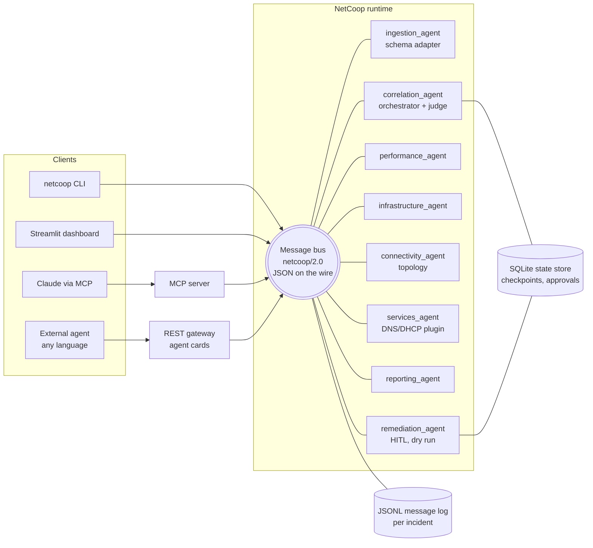

# NetCoop AI: multi-agent network fault diagnosis

Cooperating agents analyse campus network telemetry, exchange structured messages over a versioned protocol,
resolve their disagreements in a challenge round, and produce **one explainable report**: probable root cause,
affected devices, evidence, alternatives, a calibrated confidence and recommended actions. When the evidence does
not support a definite answer, the system says so (`insufficient_evidence`) and names the data that would settle it.

> **SIMULATION ONLY.** NetCoop AI works on synthetic or organizer-supplied telemetry. Nothing in this repository
> connects to, logs into or sends commands to a real network device. "Remediation" edits a copy of the synthetic
> telemetry and re-runs the diagnosis, and only after a human approves the action.

**At a glance** (from `netcoop eval --seeds 50`, 960 runs, see [Evaluation](#evaluation)): 99.8 % correct-or-abstain,
**0 high-confidence wrong answers, 0 false alarms, 0 crashes**, calibration error (ECE) 0.094. The organizer's own
generator output is diagnosed correctly (`hardware_failure`) or honestly abstained on (`latency_spike`) for every seed.

## Contents

1. [Quick start](#quick-start) · 2. [Requirement map](#requirement-map) · 3. [Architecture](#architecture) ·
4. [Agents](#agents) · 5. [Protocol](#communication-protocol) · 6. [Orchestration and the challenge round](#orchestration-and-the-challenge-round) ·
7. [Evidence and confidence](#evidence-correlation-and-confidence) · 8. [Robustness](#error-handling-and-robustness) ·
9. [Evaluation](#evaluation) · 10. [Optional features](#optional-features) · 11. [Add an agent](#add-a-new-agent-in-about-20-lines) ·
12. [Design rationale and related work](#design-rationale-and-related-work) · 13. [Limitations](#limitations-and-future-work)

## Quick start

```bash
python -m venv .venv && . .venv/bin/activate     # Windows: python -m venv .venv; .\.venv\Scripts\Activate.ps1
pip install -e ".[dev]"                          # = make setup
pytest                                           # = make test        (~390 tests, a few minutes)
netcoop run-all                                  # = make run-all     every scenario, graded against ground truth
netcoop demo                                     # = make demo        the scripted 7-step demo (< 10 s)
netcoop dashboard                                # = make dashboard   http://localhost:8501
```

No API key is needed for anything above. To share the dashboard with others, deploy it for free on Streamlit
Community Cloud: see [docs/DEPLOY.md](docs/DEPLOY.md). Other commands:

| Command | What it does |
|---|---|
| `netcoop scenarios` | List the 13 built-in scenarios |
| `netcoop diagnose --scenario link_congestion [--seed 7] [--format organizer] [--chaos rename_fields,swap_units]` | One incident with a live agent message feed |
| `netcoop diagnose --input data/organizer_samples/single_hardware_failure.json` | Any JSON, JSONL or CSV telemetry file |
| `netcoop chaos --scenario hardware_failure` | Every chaos mutation on one scenario |
| `netcoop eval --seeds 50 [--tune 0.05,0.1,0.2]` | Multi-seed accuracy, confusion matrix, calibration (writes `reports/eval/`) |
| `netcoop diagnose ... --pause-after correlation` then `netcoop resume <incident>` | Durable pause/resume |
| `netcoop actions <incident>`, `netcoop approve <incident> <action> [--reject]` | Human-in-the-loop, simulated remediation |
| `netcoop incidents` | Incidents in the state store and their phase |
| `netcoop mcp` · `netcoop gateway` · `netcoop schemas` | MCP server · REST gateway · JSON Schemas + PROTOCOL.md |

Windows users without `make` run the `netcoop` commands directly (the Makefile only wraps them).

## Requirement map

**Mandatory components** (problem statement section 4) and where to find them:

| Requirement | Where | Evidence |
|---|---|---|
| Multiple collaborating agents | 6 core agents + DNS/DHCP plugin + remediation agent, [`netcoop/agents/`](netcoop/agents/) | `tests/test_agents.py` |
| Agent interoperability | Versioned envelope, 15 typed payloads, units on every metric, JSON Schemas, [PROTOCOL.md](PROTOCOL.md) | `tests/test_protocol.py`, `tests/test_gateway.py` |
| Agent orchestration | Correlation agent: capability routing, timeouts, challenge round, decision | `tests/test_agents.py`, `tests/test_scenarios.py` |
| Network fault diagnosis | 9 hypotheses, weighted evidence, discriminating rules, topology localization | `tests/test_scenarios.py`, `reports/eval/` |
| Unified diagnostic report | Superset of the organizer's report format, validated against `schemas/report.schema.json` | `test_report_keeps_every_organizer_field_name` |
| Validation and error handling | Schema adapter with 10 error codes, quality tags, chaos harness, 16 malformed fixtures | `tests/test_ingestion.py`, `tests/test_chaos.py` |
| Reproducible testing and documentation | Seeded generators, ground-truth files, `pytest`, this README, `docs/DEMO.md` | CI workflow |

**Optional components:** MCP server · human-in-the-loop approvals · persistent pause/resume (SQLite) · Streamlit
dashboard · simulated remediation. All are implemented and tested, see [Optional features](#optional-features).

**Suggested test scenarios** (problem statement section 5), with the expected outcome:

| Scenario | Data | Expected | Result |
|---|---|---|---|
| Normal operation | `normal` | `normal`, no false alarm | ✔ 100 % over 50 seeds |
| Link congestion | `link_congestion` | congestion at the hostel uplink, downstream devices symptomatic | ✔ |
| Weak Wi-Fi | `weak_wifi` | weak_wifi at one AP, wired path healthy | ✔ |
| Ethernet/interface fault | `interface_fault` | interface_fault (rising CRC errors, flaps) | ✔ |
| DNS / DHCP failure | `dns_failure`, `dhcp_failure` | service failure while the IP path is healthy | ✔ |
| Interoperability failure | `interoperability_failure` | correct diagnosis despite renamed fields, units, legacy schema | ✔ with lower confidence |
| Organizer `hardware_failure` | `hardware_failure`, organizer samples | hardware/interface fault over congestion, alternatives listed | ✔ visible challenge round |
| Organizer `latency_spike` | `latency_spike`, organizer samples | moderate confidence or `insufficient_evidence` | ✔ abstains, names missing data |
| Extra | `device_overload`, `multi_fault`, `subtle_degradation`, `insufficient_data` | see `netcoop scenarios` | ✔ |

## Architecture



* **The bus** ([`netcoop/bus/bus.py`](netcoop/bus/bus.py)) serialises every message to JSON and every recipient decodes,
  migrates and validates its own copy. Agents share no Python objects: an in-process agent and an external agent
  behind the REST gateway use exactly the same path. Invalid messages get a structured `ERROR` back, never a crash.
* **Agents** subclass [`BaseAgent`](netcoop/agents/base.py): on start they publish `CAPABILITY_ANNOUNCE` (what they
  consume, produce, judge and answer) and a `HEARTBEAT`; any exception inside an agent becomes an `E_INTERNAL` error on
  the bus and the agent keeps running.
* **Every threshold and weight** lives in [`config/`](config/) (YAML), with the source of each threshold.

## Agents

| Agent | Responsibility | Consumes → produces |
|---|---|---|
| `ingestion_agent` | Schema adapter: JSON/JSONL/CSV; organizer v1, legacy v1.x, canonical v2; field aliases (incl. RFC 8343 names), fuzzy matching, unit conversion, schema migration, validation, quality tags, data coverage | TELEMETRY_RAW → TELEMETRY_NORMALIZED, ERROR |
| `performance_agent` | Latency, jitter, loss, utilization, throughput, Wi-Fi RSSI/SNR, retransmissions; answers *is the IP path healthy?* | TASK_ASSIGNMENT, QUERY → FINDING, RESPONSE |
| `infrastructure_agent` | Device status, CPU, memory, interface/CRC errors, queue drops, flaps, reboots | TASK_ASSIGNMENT, QUERY → FINDING, RESPONSE |
| `connectivity_agent` | Topology (NetworkX): blast radius, root vs symptomatic devices, partitions, *is the fault local or upstream?* | TASK_ASSIGNMENT, QUERY → FINDING, RESPONSE |
| `services_agent` | DNS resolution and DHCP lease health; **registered only as a plugin entry point** | TASK_ASSIGNMENT, QUERY → FINDING, RESPONSE |
| `correlation_agent` | Orchestrator and judge: routing by capability, timeouts, challenge round, decision or abstention | everything above → TASK_ASSIGNMENT, QUERY, DIAGNOSIS |
| `reporting_agent` | Report (JSON + Markdown), narrative, playbook actions | DIAGNOSIS → REPORT, REMEDIATION_PROPOSAL |
| `remediation_agent` | Human approval workflow; simulates only approved actions, then re-diagnoses | REMEDIATION_PROPOSAL, APPROVAL_DECISION → APPROVAL_REQUEST, ACK |

## Communication protocol

The full specification, with a field / type / unit / meaning table for every message (generated from the code), the
sequence diagrams, error codes and the versioning policy, is in **[PROTOCOL.md](PROTOCOL.md)**. In short:

* **Envelope** (FIPA ACL-style): `protocol`, `msg_id`, `correlation_id` (incident), `causation_id` (in-reply-to),
  `from_agent`, `to_agent` (or `broadcast`), `type` (15 types), `timestamp`, `ttl_s`, `payload_schema`, `payload`.
* **Units are explicit** on every metric and evidence item, from a canonical vocabulary that also lists UCUM codes.
* **Versioning**: minor versions are compatible both ways (additive fields + must-ignore); majors need a migration
  (`netcoop/1.0 → 1.1 → 2.0` is implemented); anything else gets `E_UNSUPPORTED_VERSION`.
* **Capability-based routing**: the correlator learns agents from their `CAPABILITY_ANNOUNCE` (retained by the bus for
  late joiners) and sends each one a `TASK_ASSIGNMENT` containing only the metrics it declared.
* **JSON Schemas** for every message are in [`schemas/`](schemas/); the gateway serves them at `/schemas/message`.

## Orchestration and the challenge round

1. The operator sends `TELEMETRY_RAW`; the correlator assigns an incident id and forwards it to whichever agent
   declares it normalizes telemetry.
2. `TASK_ASSIGNMENT`s go to every analysis agent whose declared inputs appear in the batch (the DNS/DHCP agent is not
   bothered with organizer data that has no DNS metrics). Each agent has `agent_timeout_s`; a slow or crashed agent
   becomes an `E_AGENT_TIMEOUT` / `E_INTERNAL` error and a limitation, and the diagnosis continues without it.
3. **Conflict detection**: agents name different faults, or the top two scores are within `conflict_margin`.
4. **Challenge round** (at most `max_challenge_rounds`): for the premises of the discriminating rules that separate
   the top two hypotheses, the correlator sends targeted `QUERY`s to the agent that **owns** each metric
   (*"Is interface_errors on SW_CAMPUS_4 critical?"*), asks the connectivity agent whether a fault is local or
   upstream, and asks the performance agent whether the IP path is healthy. `RESPONSE`s carry evidence; refuted
   hypotheses are penalized; rules fire only on confirmed premises. Every step is logged.
5. **Decide or abstain**, then `DIAGNOSIS` → reporting agent → `REPORT`.

Example (organizer `hardware_failure`): the performance agent sees load, loss and latency and votes
`link_congestion`; the infrastructure agent sees 382 interface errors, a pegged CPU and a Critical status and votes
`hardware_failure`. The challenge round confirms the interface errors and loss, rule
`interface_errors_beat_congestion` fires (errors come from the physical layer, not from load), and the report says
*hardware failure, alternatives: interface fault, congestion*.

## Evidence correlation and confidence

For each device `d`, metric `m` with severity `s_m` (piecewise-linear: 0 at the `warn` threshold, 1 at `crit`) and
quality factor `q_m` (ok 1.0, converted 0.8, imputed/LLM-mapped 0.5, stale 0.3, rejected 0):

```
raw(h, d) = Σ_m q_m · ( abnormal[h][m] · s_m  +  healthy[h][m] · (1 − s_m) )      weights: config/weights.yaml
S(h, d)   = raw(h, d) / Z(h)          Z(h) = Σ positive abnormal weights + Σ healthy weights
S(h)      = max over devices of S(h, d) + rule / refutation adjustments
S(normal) = 1 − worst severity observed                (deliberately not discounted by data quality)
P(h)      = softmax(S(h) / T)         T = 0.10, chosen by grid search to minimise ECE (Guo et al., 2017)

confidence = P(top) × data_coverage × agreement_factor
```

* `raw` is computed once from the **de-duplicated** observations (one per device and metric), so two agents judging
  the same metric never count it twice. Healthy-weight evidence can support a hypothesis but never create one.
* `data_coverage`: share of the top hypothesis' evidence profile that was observed, quality-weighted.
* `agreement_factor`: share of eligible agents whose own top hypothesis matches; an agent whose dissent was refuted in
  the challenge round counts 0.75; agents that cannot judge the hypothesis abstain from the vote.
* **Abstain** (`insufficient_evidence`) when confidence < 0.55, or P(top) − P(second) < 0.15, or a required
  corroboration is missing (e.g. *upstream_issue* needs neighbour data), or a fault would rest only on baseline drift.
  A claim that cannot be verified has its confidence multiplied by 0.3 so the number stays calibrated.
* **Never "all clear" while something is abnormal**: `normal` is refused when any signal has severity ≥ 0.5, or when
  a signal has drifted from its own baseline (an early warning).
* **Categories**: high ≥ 0.8, medium ≥ 0.55, low below.
* **Localization** (Sherlock-style): devices whose symptoms are explained by a fault on an ancestor are reported as
  symptomatic; a strong fault outside the root's subtree becomes a **secondary incident** (SCORE-style greedy cover).
* **Baseline deviation** (NetMedic-style): a robust z-score (median/MAD with a guard band) flags drift below the fixed
  thresholds; it needs z ≥ 4 and a material move toward the threshold, is capped at severity 0.4, and can raise an
  early warning but never a diagnosis on its own.

## Error handling and robustness

* **Ingestion never raises.** Every problem is a `RejectionNote` with a protocol error code (`E_SCHEMA_INVALID`,
  `E_UNIT_UNKNOWN`, `E_FIELD_UNMAPPED`, `E_MISSING_REQUIRED`, `E_OUT_OF_RANGE`, `E_STALE_DATA`,
  `E_UNSUPPORTED_VERSION`, `E_UNKNOWN_DEVICE`, ...), every change is a `ConversionNote`, and every value carries a
  quality tag and its provenance (original field, value and unit). Absent metrics are *missing*, never zero.
* **Staleness is judged against the batch**, not the wall clock, so organizer files generated hours earlier are not
  all marked stale; a record three hours older than the rest is.
* **16 malformed fixtures** ([`data/malformed/`](data/malformed/): truncated JSON, wrong types, NaN, negative values,
  percent > 100, empty, binary garbage, unknown device, future timestamps, duplicates, bad CSV, unsupported schema,
  ...): each yields a clear error code and a report, never a traceback.
* **Agent failures are contained**: a crashed or silent agent becomes an error message and a limitation.

**Chaos harness** ([`netcoop/sim/chaos.py`](netcoop/sim/chaos.py), `netcoop chaos`, `tests/test_chaos.py`): ten
composable mutations applied to clean scenarios. One mutation at a time (seed 0,
[`reports/eval/robustness_matrix.md`](reports/eval/robustness_matrix.md)); C = correct, A = abstained:

| scenario | rename | units | drop | NaN | v1.1 schema | shuffle | noise | duplicates | stale | flatten/nest |
|---|---|---|---|---|---|---|---|---|---|---|
| normal | C | C | C | C | C | C | C | C | C | C |
| link_congestion | C | C | C | C | C | C | C | C | C | C |
| weak_wifi | C | C | C | C | C | C | C | C | C | C |
| interface_fault | C | C | C | C | C | C | C | C | C | C |
| dns_failure | C | C | C | C | C | C | C | C | C | C |
| dhcp_failure | C | C | C | C | C | C | C | C | C | C |
| device_overload | C | C | C | C | C | C | C | C | C | C |
| hardware_failure | C | C | C | C | C | C | C | C | C | C |
| latency_spike | C | C | C | C | C | C | C | C | C | C |
| interoperability_failure | C | A | C | C | C | C | C | C | C | C |
| multi_fault | C | C | C | C | C | C | C | C | C | C |
| subtle_degradation | C | C | C | C | C | C | C | C | C | C |
| insufficient_data | C | C | C | C | C | C | C | C | C | C |

129 correct, 1 abstained (`interoperability_failure` is already unit-swapped; swapping again genuinely corrupts the
values), **0 wrong, 0 crashes**. A sweep of every *pair* of mutations over all scenarios (`python scripts/chaos.py
--pairs --seeds 2`) also produced 0 wrong answers and 0 crashes.

## Evaluation

`netcoop eval --seeds 50` runs every scenario over 50 seeds, a chaos slice, fresh organizer records (single and
batches of 10) and grades each report against ground truth (correct / abstain / wrong). Results are committed in
[`reports/eval/`](reports/eval/) ([summary](reports/eval/summary.md)).

| Metric | Target (master brief) | Result |
|---|---|---|
| Correct or abstain, every scenario | ≥ 95 % | 99.8 % overall (lowest group: chaos runs of `subtle_degradation`, 80 %) |
| High-confidence wrong answers | 0 | **0** |
| False alarms on `normal` | 0 | **0** |
| Expected calibration error | < 0.1 | 0.094 (Brier 0.024) |


The reliability diagram shows the system is never over-confident; the remaining calibration gap is
*under*-confidence, mostly organizer `hardware_failure` (always right, reported at ~0.67 because that format carries no
uptime or link-flap data, so the evidence profile is only 78 % observed). Calibration excludes `latency_spike` runs,
whose ground truth accepts several causes without naming one.

## Optional features

| Feature | How | Notes |
|---|---|---|
| **Dashboard** | `netcoop dashboard` | Report card with confidence gauge; agent conversation as a sequence diagram with the challenge round highlighted; topology coloured by state; telemetry with threshold lines; data quality; Approve/Reject; evaluation |
| **Human-in-the-loop** | dashboard buttons, `netcoop approve`, MCP `simulate_remediation` | `REMEDIATION_PROPOSAL → APPROVAL_REQUEST → APPROVAL_DECISION → ACK`; rejected actions are never simulated; decisions are final and logged |
| **Simulated remediation** | [`netcoop/remediation/simulator.py`](netcoop/remediation/simulator.py) | Applies the action's effect (reroute, port bounce, failover, CoPP, DNS/DHCP failover) as a new window of samples, then runs the full multi-agent diagnosis again, e.g. congestion → `normal` |
| **Pause / resume** | `--pause-after ingestion\|correlation`, `netcoop resume` | SQLite checkpoints (normalized telemetry, findings, diagnosis); resume works from a new process; a crashed run resumes from its last checkpoint |
| **MCP server** | `netcoop mcp`; `claude mcp add netcoop -- <venv>/python -m netcoop.mcp_server.server` | Tools: `list_devices`, `get_topology`, `get_telemetry`, `run_diagnosis`, `get_report`, `list_actions`, `simulate_remediation`; resources: vocabulary, thresholds, protocol |
| **REST gateway** | `netcoop gateway` | External agents register with a `CAPABILITY_ANNOUNCE`, poll an inbox, post messages; A2A-style Agent Cards at `/.well-known/agent-card.json` and per agent. [`examples/external_agent_http.py`](examples/external_agent_http.py) joins a live incident using only JSON |
| **LLM narrative** (optional) | `NETCOOP_LLM=1` + Anthropic credentials; model `NETCOOP_LLM_MODEL` (default `claude-sonnet-5-5`) | Writes the summary paragraph and suggests names for unmappable fields. It never changes the root cause or confidence; inconsistent output is discarded; any failure falls back to the template |
| **Logs** | `reports/<incident>/messages.jsonl`, `report.json`, `report.md` | The JSONL log is the exact wire traffic and can be replayed through the decoder |

## Add a new agent in about 20 lines

[`examples/custom_agent.py`](examples/custom_agent.py):

```python
from netcoop.agents.analysis import AnalysisAgent
from netcoop.agents.registry import register_agent
from netcoop.protocol.payloads import Skill
from netcoop.protocol.vocabulary import Hypothesis

WIFI = ("wifi_rssi_dbm", "wifi_snr_db", "retransmission_pct")

@register_agent
class WirelessAgent(AnalysisAgent):
    name = "wireless_agent"
    description = "Wi-Fi radio health: signal strength, noise and retransmissions"
    inputs = WIFI       # metrics it wants in its TASK_ASSIGNMENTs
    metrics = WIFI      # metrics it judges and answers QUERYs about
    hypotheses = (Hypothesis.WEAK_WIFI,)
    skills = (Skill(id="rf-health", name="RF health", tags=["wifi", "rf"]),)
```

Register it with the decorator or under `[project.entry-points."netcoop.agents"]` in `pyproject.toml` (that is how
the DNS/DHCP agent joins). The correlator discovers it from its announcement, routes it the Wi-Fi metrics, counts its
vote and can query it in a challenge round; no orchestrator code changes. A test checks that adding it leaves the
probabilities unchanged (no double counting). Agents in other languages join through the REST gateway instead.

## Design rationale and related work

Each row below is used in the code; references were checked against their publications.

| Reference | Idea used | Where |
|---|---|---|
| Bahl et al., *Towards Highly Reliable Enterprise Network Services via Inference of Multi-level Dependencies* (Sherlock), SIGCOMM 2007 | Localize the root by the single upstream fault that best explains the symptoms | Connectivity agent clusters and judge "explain-away"; root vs symptomatic devices. Simplified: a topology tree, not Sherlock's probabilistic inference graph |
| Kandula et al., *Detailed Diagnosis in Enterprise Networks* (NetMedic), SIGCOMM 2009 | Judge a component by how abnormal it is relative to its own history; rank likely culprits | Robust baseline z-score and early warnings; ranked `alternative_causes` |
| Kompella et al., *IP Fault Localization via Risk Modeling* (SCORE), NSDI 2005 | Smallest set of causes that explains all symptoms | Secondary incidents (greedy cover) in `multi_fault`; simplified, no shared-risk groups |
| Chen et al., *Automatic Root Cause Analysis via Large Language Models for Cloud Incidents* (RCACopilot), EuroSys 2024 | Gather diagnostic evidence with handlers first, let the model explain afterwards | Deterministic agents decide; the optional LLM only narrates |
| Roy et al., *Exploring LLM-based Agents for Root Cause Analysis*, FSE 2024 (industry) | Grounding and hallucination are the main risks of agentic RCA | Root cause and confidence never come from an LLM |
| Wang et al., *RCAgent: Cloud Root Cause Analysis by Autonomous Agents with Tool-Augmented LLMs*, CIKM 2024 | Tool-augmented agents; aggregate several reasoning paths | Targeted re-queries in the challenge round; agreement factor |
| Xu et al., *OpenRCA: Can Large Language Models Locate the Root Cause of Software Failures?*, ICLR 2025 | End-to-end LLM RCA from raw telemetry is still weak (best agent solved 11.34 % of cases) | Motivation for the deterministic core |
| Chen et al., *AIOpsLab: A Holistic Framework to Evaluate AI Agents for Enabling Autonomous Clouds*, 2025 (arXiv 2501.06706) | Fault injection with ground truth for reproducible evaluation | Chaos harness, scenario generator, `netcoop eval` |
| Du et al., *Improving Factuality and Reasoning in Language Models through Multiagent Debate*, 2023 (arXiv 2305.14325) | Agents critique each other over rounds and converge | Bounded, logged challenge round (deterministic here) |
| Cemri et al., *Why Do Multi-Agent LLM Systems Fail?* (MAST), 2025 (arXiv 2503.13657) | Failures come from system design, inter-agent misalignment and weak task verification | See the table below |
| Anthropic, *Building effective agents*, Dec 2024 | Simple composable workflows: orchestrator-workers, evaluator loop | Correlator = orchestrator-workers; challenge round = evaluator loop |
| FIPA ACL Message Structure Specification (SC00061G) | Sender, receiver, conversation-id, in-reply-to, ontology, protocol | Envelope field mapping in PROTOCOL.md |
| Agent2Agent (A2A) protocol | Agent Cards for capability discovery at `/.well-known/agent-card.json` | Gateway agent cards built from `CAPABILITY_ANNOUNCE` |
| Model Context Protocol | Standard tools and resources for models | MCP server |
| OpenTelemetry semantic conventions; UCUM | Consistent metric names and unit codes | Vocabulary (`schemas/vocabulary.json`) |
| IETF RFC 8343, *A YANG Data Model for Interface Management* | Standard interface counters (`in-errors`, `out-discards`, `oper-status`) | Field aliases and status mapping |
| Schema-registry compatibility rules (backward / forward / full) | Compatible minor versions, migrated majors | Versioning policy |
| ITU-T G.114 (≈150 ms one-way delay for good interactivity), ITU-T Y.1541 (class 0: 100 ms delay, 50 ms delay variation, 10⁻³ loss) | Defensible latency, jitter and loss thresholds | `config/thresholds.yaml`. Note: G.114 is one-way end-to-end delay; we apply 150 ms conservatively as the critical bound for RTT to the core |
| Guo et al., *On Calibration of Modern Neural Networks*, ICML 2017 | ECE, reliability diagrams, temperature scaling | `netcoop eval`, temperature grid search |

Wi-Fi thresholds (−67 dBm RSSI, 25 dB SNR) follow common enterprise Wi-Fi design guidance; thresholds without a
standard are marked *empirical* in `config/thresholds.yaml`.

**How we address the MAST failure categories**

| MAST category | Risk | NetCoop safeguard |
|---|---|---|
| System design issues | Underspecified roles, unclear termination | One responsibility per agent with declared capabilities; bounded challenge rounds; per-agent timeouts; explicit abstention |
| Inter-agent misalignment | Agents misunderstand messages or ignore each other | Typed, versioned, validated messages with units; capability-based routing; disagreements surfaced and resolved by evidence, not by majority |
| Task verification | Wrong answers accepted unchecked | Rule premises confirmed by the owning agent; report validated against its schema; ground-truth grading, chaos tests and calibration in CI |

## Limitations and future work

* All evaluation is on synthetic data (the problem statement forbids touching the campus network). It shows the logic
  is correct and robust on data shaped like the brief; it does not measure real-world accuracy.
* Weights and thresholds were tuned on the same generators they are evaluated on; real telemetry would need re-tuning
  (every value is in `config/`).
* Early warnings need a clean history: when 30 % of a drifting device's samples are deleted or shifted, the drift can be
  missed (2 of 10 such chaos runs); the system then reports `normal` with reduced confidence.
* Localization uses a topology tree, not a full probabilistic dependency graph; SCORE's shared-risk groups are not
  modelled.
* Future work: streaming telemetry, learned weights from labelled incidents, real SNMP/streaming-telemetry adapters.

## Repository layout

```
config/            thresholds, weights, scoring, orchestration, field aliases, units, remediation playbook
netcoop/protocol/  vocabulary, payloads, envelope, migrations, schema export, PROTOCOL.md generator
netcoop/bus/       message bus, JSONL log, SQLite state store
netcoop/agents/    base, ingestion, performance, infrastructure, connectivity, services, correlation, reporting, remediation
netcoop/scoring/   evidence, hypotheses, confidence, judge
netcoop/ingest/    schema adapter
netcoop/sim/       organizer generator (exact copy), scenario generator, chaos mutations, malformed fixtures
netcoop/           pipeline, CLI, benchmark, viz, topology, remediation/, llm/, mcp_server/, gateway/
dashboard/app.py   Streamlit dashboard
data/              topology, scenarios + truth, organizer samples, malformed fixtures
schemas/           JSON Schemas (generated)
reports/eval/      committed evaluation results
examples/          external HTTP agent, custom agent
tests/             ~390 tests
```
