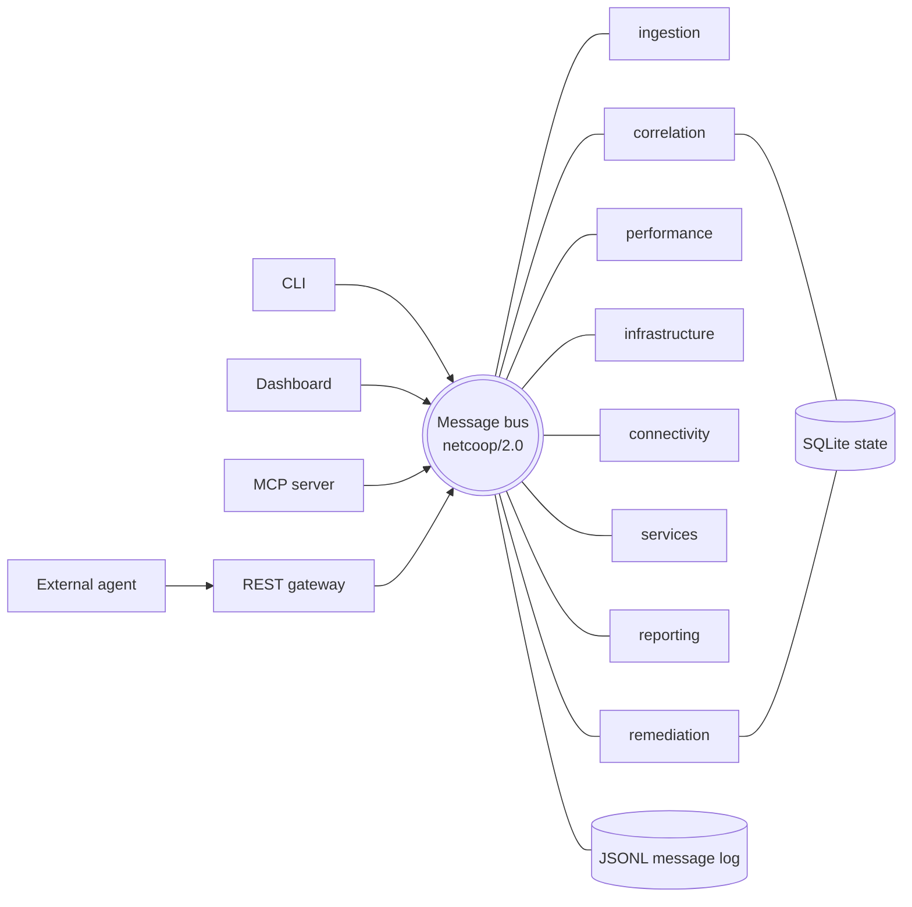
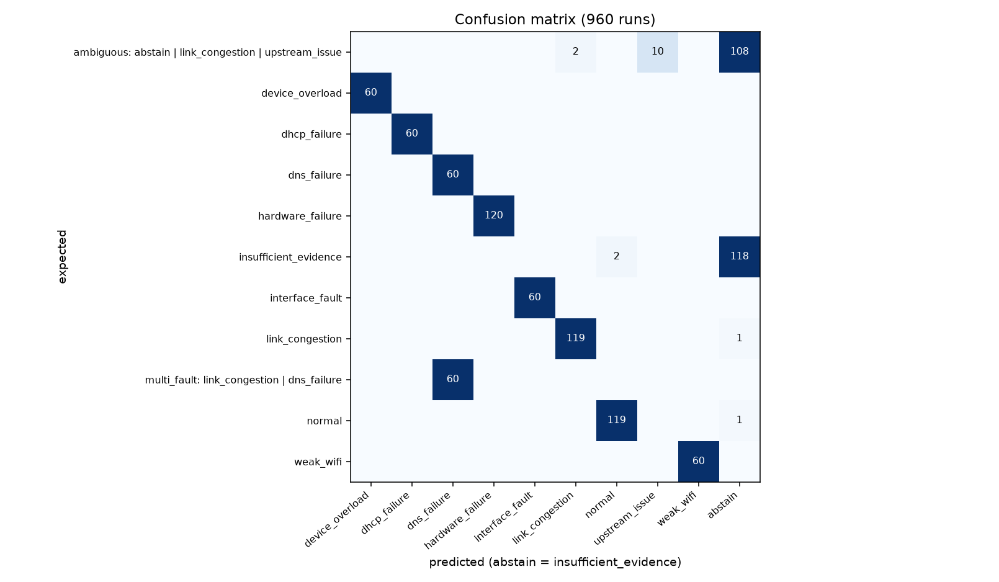
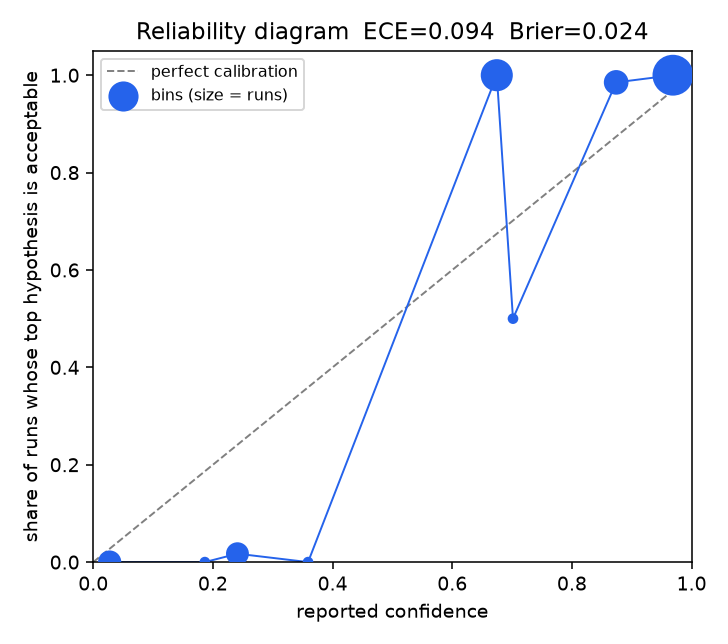

# NetCoop AI

Multi-agent fault diagnosis for a campus network. Several agents each look at one part of the telemetry
(performance, device health, topology, DNS/DHCP), exchange typed JSON messages over a small versioned protocol, argue
it out when they disagree, and produce a single report: the probable root cause, the affected devices, the evidence,
the alternatives, a confidence value and recommended actions. When the data does not support a definite answer, the
report says `insufficient_evidence` and lists what data would settle it.

Live dashboard: https://netcoop-ai.streamlit.app

Everything runs on synthetic or organizer-supplied telemetry. Remediation is simulation only: nothing here connects
to or changes a real network device, and every action needs a human to approve it first.

## Results

Measured with `netcoop eval --seeds 50` (960 runs: every scenario over 50 seeds, a set of corrupted inputs, and fresh
output from the organizer's generator):

| | Result |
|---|---|
| Correct, or abstained where the ground truth allows it | 99.8 % |
| Wrong answers given with high confidence | 0 |
| False alarms on healthy data | 0 |
| Crashes | 0 |
| Expected calibration error (ECE) | 0.094 (Brier score 0.024) |

The organizer's `hardware_failure` records are always diagnosed as a hardware failure, and its `latency_spike` records
are reported as insufficient evidence, which is the correct answer for a single record with no neighbouring data.

## Running it

Python 3.11 or newer.

```bash
python -m venv .venv
. .venv/bin/activate              # Windows: .\.venv\Scripts\Activate.ps1
pip install -e ".[dev]"

pytest                            # about 390 tests, a few minutes
netcoop run-all                   # every scenario, graded against its ground truth
netcoop demo                      # short scripted walkthrough in the terminal
netcoop dashboard                 # http://localhost:8501
```

No API key is needed. The Makefile wraps the same commands (`make setup`, `make test`, `make run-all`, `make demo`).
The hosted dashboard runs on Streamlit Community Cloud from `dashboard/app.py`.

Other commands:

| Command | Purpose |
|---|---|
| `netcoop scenarios` | list the built-in scenarios |
| `netcoop diagnose --scenario link_congestion` | run one scenario with a live view of the agent messages |
| `netcoop diagnose --input data/organizer_samples/single_hardware_failure.json` | diagnose any JSON, JSONL or CSV telemetry file |
| `netcoop diagnose ... --chaos rename_fields,swap_units` | corrupt the input first |
| `netcoop chaos --scenario all --pairs` | run the chaos mutations over every scenario |
| `netcoop eval --seeds 50 --tune 0.05,0.1,0.2` | accuracy, confusion matrix and calibration, written to `reports/eval/` |
| `netcoop diagnose ... --pause-after correlation`, `netcoop resume <id>` | pause an incident and continue it later |
| `netcoop actions <id>`, `netcoop approve <id> <action> [--reject]` | review and approve the proposed actions |
| `netcoop mcp`, `netcoop gateway`, `netcoop schemas` | MCP server, REST gateway, regenerate the JSON Schemas and PROTOCOL.md |

## How the problem statement maps to the code

| Requirement | Where |
|---|---|
| Multiple collaborating agents | `netcoop/agents/`: six core agents, a DNS/DHCP agent loaded as a plugin, and a remediation agent |
| Agent interoperability | Versioned message envelope with typed payloads and explicit units, JSON Schemas in `schemas/`, specification in [PROTOCOL.md](PROTOCOL.md) |
| Agent orchestration | `netcoop/agents/correlation.py`: routes tasks by capability, enforces timeouts, runs the challenge round, decides or abstains |
| Network fault diagnosis | `netcoop/scoring/`: weighted evidence per hypothesis, discriminating rules, topology-based localization |
| Unified diagnostic report | A superset of the sample report format (same field names), validated against `schemas/report.schema.json` |
| Validation and error handling | `netcoop/ingest/adapter.py`, 16 malformed input files in `data/malformed/`, chaos tests |
| Reproducible testing and documentation | Seeded generators with ground-truth files, `tests/`, CI, this README and PROTOCOL.md |
| Optional: MCP, human-in-the-loop, pause/resume, dashboard, remediation | All implemented; see [Optional features](#optional-features) |

Test scenarios (`netcoop scenarios`): `normal`, `link_congestion`, `weak_wifi`, `interface_fault`, `dns_failure`,
`dhcp_failure`, `device_overload`, `hardware_failure` and `latency_spike` (both copied exactly from the organizer's
generator), `interoperability_failure` (renamed fields, mixed units, legacy schema), `multi_fault`,
`subtle_degradation` and `insufficient_data`. Each has a ground-truth file in `data/scenarios/`.

## Architecture



Agents never call each other directly. The bus serializes every message to JSON, and each recipient decodes and
validates its own copy, so an agent in the same process and an agent talking through the REST gateway use exactly the
same path. A message that fails validation is answered with an `ERROR`; an exception inside an agent becomes an
`E_INTERNAL` error on the bus, and the agent keeps running. All thresholds and weights are in `config/`.

| Agent | Job |
|---|---|
| ingestion | Parses JSON, JSONL or CSV in the organizer format, the canonical format or older variants. Maps renamed fields, converts units, migrates old schemas, validates values and tags each one with a quality label |
| performance | Latency, jitter, loss, utilization, throughput, Wi-Fi signal and retransmissions |
| infrastructure | Device status, CPU, memory, interface errors, queue drops, link flaps, reboots |
| connectivity | Places symptoms on the campus topology: which device is the root, which are only showing symptoms, whether a fault is local or upstream |
| services | DNS resolution and DHCP leases. Registered only through a plugin entry point, to show that new agents need no core changes |
| correlation | Coordinates the incident and makes the decision |
| reporting | Writes the JSON and Markdown report and picks recommended actions |
| remediation | Asks a human to approve actions and simulates only the approved ones |

## Protocol

[PROTOCOL.md](PROTOCOL.md) has the full specification, generated from the code: a table of every field with its type,
unit and meaning, sequence diagrams, error codes and the versioning rules. In short:

- The envelope follows FIPA ACL: `type` (the performative), `from_agent`, `to_agent`, `correlation_id` (the incident),
  `causation_id` (in-reply-to), `payload_schema` (the ontology), `protocol` and `ttl_s`.
- Every metric value carries its unit.
- On start, each agent announces what it consumes, produces and can answer. The correlator uses these announcements
  to decide who gets which task, so it never hard-codes agent names.
- Minor versions only add optional fields, and unknown fields are ignored, so they work in both directions.
  `netcoop/1.x` messages are migrated to 2.0. Any other major version is answered with `E_UNSUPPORTED_VERSION`.

## How a diagnosis is made

1. The correlator sends the raw telemetry to the ingestion agent, then sends each analysis agent a task containing
   only the metrics it declared. Each agent has a timeout. A slow or crashed agent is recorded as a limitation, and
   the diagnosis continues without it.
2. Each agent replies with evidence and its own best explanation.
3. If agents disagree, or the two best explanations score too close together, the correlator runs a challenge round.
   It asks the agent that owns the relevant data a targeted question, for example "Is interface_errors on SW_CAMPUS_4
   critical?", "Is the fault local or upstream of this switch?" or "Is the IP path to the DNS server healthy?". The
   answers confirm or refute the premises of rules that tell causes apart, and the scores are updated. There are at
   most two rounds, and every question and answer is logged.
4. The correlator either decides or abstains, and the reporting agent writes the report.

Example with the organizer's `hardware_failure` record: the performance agent sees high load, loss and latency and
suggests link congestion. The infrastructure agent sees 382 interface errors, CPU at 99.9 % and a Critical status and
suggests hardware failure. The challenge round confirms the interface errors and the loss, and the rule
"interface errors with loss point to the physical layer, not to load" applies. The report gives hardware failure,
with interface fault and congestion as the alternatives.

### Scoring and confidence

For each device and metric, severity `s` rises linearly from 0 at the warning threshold to 1 at the critical
threshold. Each value also has a quality factor `q`: 1.0 for clean data, 0.8 for converted, 0.5 for imputed and 0.3
for stale.

```
raw(h, d)  = Σ q · ( w_abnormal(h, m) · s  +  w_healthy(h, m) · (1 − s) )      weights in config/weights.yaml
S(h, d)    = raw(h, d) / (total positive weight of h)
S(h)       = best device score for h, adjusted by confirmed rules and refutations
S(normal)  = 1 − worst severity seen
P(h)       = softmax(S(h) / T),  T = 0.10 (chosen by grid search to minimize calibration error)

confidence = P(top) × data coverage × agreement
```

- Data coverage is the share of the top hypothesis' expected evidence that was actually observed.
- Agreement is the share of agents able to judge the top hypothesis that also chose it. An agent whose objection was
  refuted in the challenge round counts as 0.75.
- Each observation is counted once, even if two agents report on the same metric.
- The report says `insufficient_evidence` when confidence is below 0.55, when the two best options are within 0.15
  of each other, when a claim needs corroboration that is missing (an upstream fault needs data from neighbouring
  devices), or when the only signal is drift from a device's own history. In that case the confidence is reduced so
  the number stays honest.
- `normal` is never reported while any signal is clearly abnormal.
- Confidence categories: high from 0.8, medium from 0.55, low below that.

Two ideas come from the network diagnosis literature:

- **Localization (Sherlock).** A device whose symptoms are explained by a fault upstream is listed as symptomatic,
  and a strong fault elsewhere in the tree is reported as a separate secondary incident.
- **Early warning (NetMedic).** A robust z-score against the device's own history flags slow drift that stays below
  the thresholds. It can only raise an early warning, never a diagnosis on its own.

## Robustness

The ingestion agent never raises an exception. Each problem is recorded with a protocol error code (for example
`E_SCHEMA_INVALID`, `E_UNIT_UNKNOWN`, `E_OUT_OF_RANGE`, `E_STALE_DATA`, `E_UNKNOWN_DEVICE`), each change with a
conversion note, and each value keeps its original field name, value and unit. A metric that is absent is treated as
missing, never as zero. Staleness is measured against the newest record in the batch rather than the wall clock, so a
file generated hours ago is still usable.

The 16 files in `data/malformed/` cover truncated JSON, wrong types, NaN, negative values, percentages over 100,
empty files, binary data, unknown devices, future timestamps, duplicates, broken CSV and unsupported schema versions.
Each produces a clear error code and a report, never a traceback.

`netcoop chaos` applies ten input mutations to clean scenarios. With one mutation at a time, over every scenario:

| scenario | rename | units | drop | NaN | old schema | shuffle | noise | duplicates | stale | flatten |
|---|---|---|---|---|---|---|---|---|---|---|
| normal | C | C | C | C | C | C | C | C | C | C |
| link_congestion | C | C | C | C | C | C | C | C | C | C |
| weak_wifi | C | C | C | C | C | C | C | C | C | C |
| interface_fault | C | C | C | C | C | C | C | C | C | C |
| dns_failure | C | C | C | C | C | C | C | C | C | C |
| dhcp_failure | C | C | C | C | C | C | C | C | C | C |
| device_overload | C | C | C | C | C | C | C | C | C | C |
| hardware_failure | C | C | C | C | C | C | C | C | C | C |
| latency_spike | C | C | C | C | C | C | C | C | C | C |
| interoperability_failure | C | A | C | C | C | C | C | C | C | C |
| multi_fault | C | C | C | C | C | C | C | C | C | C |
| subtle_degradation | C | C | C | C | C | C | C | C | C | C |
| insufficient_data | C | C | C | C | C | C | C | C | C | C |

C means correct and A means abstained. There were no wrong answers and no crashes. The one abstention is expected:
that scenario's units are already swapped, so swapping them again really does corrupt the values.
`netcoop chaos --scenario all --pairs --seed 0 --seeds 2` runs every pair of mutations as well, and also produces no
wrong answers or crashes.

## Evaluation




The reliability diagram shows the system is never overconfident; where it is off, it is underconfident. The main
case is the organizer's hardware-failure record, which is always diagnosed correctly but reported at about 0.67,
because that format has no uptime or link-flap data. Calibration excludes `latency_spike` runs, because their ground
truth accepts more than one cause.

## Optional features

- **Dashboard** (`netcoop dashboard`). Report with a confidence gauge, the agent conversation as a sequence diagram,
  the topology colored by device state, telemetry charts with threshold lines, data quality, approve/reject buttons
  and the evaluation results.
- **Human-in-the-loop and simulated remediation.** Proposed actions become approval requests. A rejected action is
  never simulated. An approved one is applied to a copy of the telemetry (rerouting traffic, bouncing a port, failing
  over a device or a DNS/DHCP server), after which the full diagnosis runs again. In the congestion scenario, the
  re-diagnosis comes back `normal`.
- **Pause and resume.** Checkpoints are stored in SQLite after ingestion, analysis and the decision. A paused or
  crashed incident can be resumed from another process.
- **MCP server** (`netcoop mcp`). Tools: `list_devices`, `get_topology`, `get_telemetry`, `run_diagnosis`,
  `get_report`, `list_actions` and `simulate_remediation`. Resources: the vocabulary, the thresholds and the protocol.
  To add it to Claude Code: `claude mcp add netcoop -- <venv>/python -m netcoop.mcp_server.server`.
- **REST gateway** (`netcoop gateway`). External agents register with a capability announcement, poll an inbox and
  post messages. Agent cards are served at `/.well-known/agent-card.json`. `examples/external_agent_http.py` takes
  part in a live incident using only JSON.
- **LLM narrative** (off by default; `NETCOOP_LLM=1` plus Anthropic credentials). It writes the summary paragraph and
  can suggest names for unrecognized fields. It never changes the root cause or the confidence, and the template text
  is used whenever it fails.
- **Logs.** Each incident gets `messages.jsonl` (the exact wire traffic), `report.json` and `report.md`. Examples are
  in `reports/examples/`.

## Adding an agent

`examples/custom_agent.py` adds a Wi-Fi specialist:

```python
@register_agent
class WirelessAgent(AnalysisAgent):
    name = "wireless_agent"
    description = "Wi-Fi radio health: signal strength, noise and retransmissions"
    inputs = WIFI       # metrics it receives in its tasks
    metrics = WIFI      # metrics it judges and answers questions about
    hypotheses = (Hypothesis.WEAK_WIFI,)
    skills = (Skill(id="rf-health", name="RF health", tags=["wifi", "rf"]),)
```

Register it with the decorator or under `[project.entry-points."netcoop.agents"]`; the DNS/DHCP agent is registered
the second way. The correlator finds it through its announcement, so no orchestration code changes. Agents written in
other languages can join through the REST gateway instead.

## Related work

| Reference | What we took from it |
|---|---|
| Bahl et al., *Towards Highly Reliable Enterprise Network Services via Inference of Multi-level Dependencies* (Sherlock), SIGCOMM 2007 | Prefer the single upstream fault that explains the most symptoms. We use a simpler topology tree, not Sherlock's probabilistic inference graph |
| Kandula et al., *Detailed Diagnosis in Enterprise Networks* (NetMedic), SIGCOMM 2009 | Judge a component against its own history; rank the likely culprits |
| Kompella et al., *IP Fault Localization via Risk Modeling* (SCORE), NSDI 2005 | Explain all symptoms with as few causes as possible (secondary incidents). We do not model shared-risk groups |
| Chen et al., *Automatic Root Cause Analysis via Large Language Models for Cloud Incidents* (RCACopilot), EuroSys 2024 | Gather the evidence first and explain it afterwards; here the LLM only writes the narrative |
| Roy et al., *Exploring LLM-based Agents for Root Cause Analysis*, FSE 2024 | Hallucination and weak grounding are the main risks, so the decision is not made by an LLM |
| Wang et al., *RCAgent*, CIKM 2024; Du et al., *Improving Factuality and Reasoning in Language Models through Multiagent Debate*, arXiv 2305.14325 | Re-query the evidence and let agents challenge each other over a few rounds (here deterministic and logged) |
| Xu et al., *OpenRCA*, ICLR 2025 | End-to-end LLM root-cause analysis is still weak; the best agent solved 11.34 % of cases |
| Chen et al., *AIOpsLab*, arXiv 2501.06706 | Fault injection with ground truth for reproducible evaluation |
| Cemri et al., *Why Do Multi-Agent LLM Systems Fail?* (MAST), arXiv 2503.13657 | Three failure groups: system design, misalignment between agents, weak verification. We address them with one role per agent and bounded rounds, typed and validated messages, and ground-truth tests and calibration |
| Anthropic, *Building effective agents*, 2024 | Orchestrator-workers and an evaluator loop |
| FIPA ACL message structure (SC00061G), A2A agent cards, Model Context Protocol, OpenTelemetry and UCUM units, RFC 8343 interface counters | Envelope fields, capability discovery, tool exposure, metric names and units, field aliases |
| ITU-T G.114 (about 150 ms one-way delay) and Y.1541 (class 0: 100 ms delay, 50 ms delay variation, 10⁻³ loss) | Latency, jitter and loss thresholds. G.114 is a one-way end-to-end figure; we use 150 ms as a conservative critical level for round-trip time to the core |
| Guo et al., *On Calibration of Modern Neural Networks*, ICML 2017 | ECE, reliability diagrams and temperature scaling |

Thresholds without a standard behind them are marked "empirical" in `config/thresholds.yaml`.

## Limitations

- All testing uses synthetic data, because the problem statement does not allow touching the campus network. The
  results show that the logic is correct and robust on data of this shape, not how accurate it would be on a real
  network.
- Weights and thresholds were tuned on the same generators they are evaluated on. Real telemetry would need retuning;
  every value is in `config/`.
- Early warnings depend on clean history. In 2 of 10 runs where 30 % of a drifting device's samples were deleted or
  moved, the drift was missed and the report said `normal`, with reduced confidence.
- Localization uses a topology tree rather than a full probabilistic dependency graph.

## Layout

```
config/            thresholds, weights, scoring, timeouts, field aliases, units, action playbook
netcoop/           agents, protocol, bus and state store, scoring, ingestion, simulators, CLI, MCP server, gateway
dashboard/app.py   Streamlit dashboard
data/              topology, scenarios with ground truth, organizer samples, malformed inputs
schemas/           JSON Schemas (generated)
reports/           evaluation results and example reports
examples/          external HTTP agent, custom agent
scripts/           regenerate the sample data
tests/             test suite
```

MIT licensed, see [LICENSE](LICENSE).
