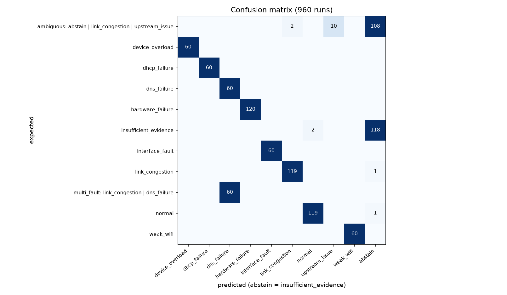
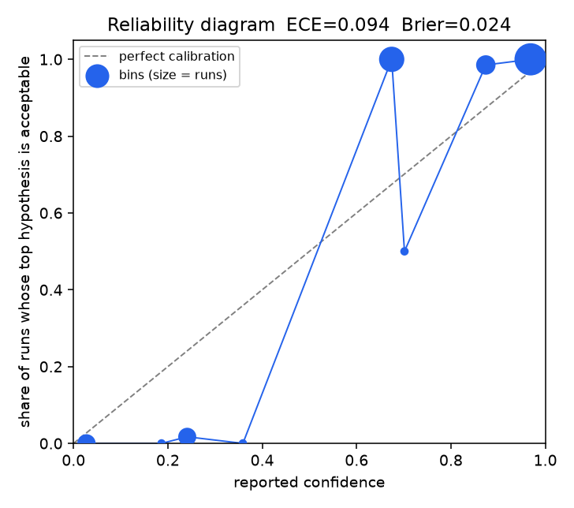

# NetCoop AI evaluation

960 runs in 60.5 s. Correct-or-abstain **99.8%**, accuracy 99.6%, abstention rate 23.8%, wrong 2, **high-confidence wrong 0**, normal false alarms 0, crashes 0. ECE **0.094**, Brier 0.024.

| group | runs | correct | abstain | wrong | correct-or-abstain | high-conf wrong | mean conf |
|---|---|---|---|---|---|---|---|
| chaos:device_overload | 10 | 10 | 0 | 0 | 100.0% | 0 | 0.96 |
| chaos:dhcp_failure | 10 | 10 | 0 | 0 | 100.0% | 0 | 0.94 |
| chaos:dns_failure | 10 | 10 | 0 | 0 | 100.0% | 0 | 0.91 |
| chaos:hardware_failure | 10 | 10 | 0 | 0 | 100.0% | 0 | 0.67 |
| chaos:insufficient_data | 10 | 10 | 0 | 0 | 100.0% | 0 | 0.03 |
| chaos:interface_fault | 10 | 10 | 0 | 0 | 100.0% | 0 | 0.95 |
| chaos:interoperability_failure | 10 | 9 | 1 | 0 | 100.0% | 0 | 0.83 |
| chaos:latency_spike | 10 | 10 | 0 | 0 | 100.0% | 0 | 0.29 |
| chaos:link_congestion | 10 | 10 | 0 | 0 | 100.0% | 0 | 0.98 |
| chaos:multi_fault | 10 | 10 | 0 | 0 | 100.0% | 0 | 0.91 |
| chaos:normal | 10 | 10 | 0 | 0 | 100.0% | 0 | 0.91 |
| chaos:subtle_degradation | 10 | 8 | 0 | 2 | 80.0% | 0 | 0.33 |
| chaos:weak_wifi | 10 | 10 | 0 | 0 | 100.0% | 0 | 0.98 |
| device_overload | 50 | 50 | 0 | 0 | 100.0% | 0 | 0.97 |
| dhcp_failure | 50 | 50 | 0 | 0 | 100.0% | 0 | 0.94 |
| dns_failure | 50 | 50 | 0 | 0 | 100.0% | 0 | 0.93 |
| hardware_failure | 50 | 50 | 0 | 0 | 100.0% | 0 | 0.68 |
| insufficient_data | 50 | 50 | 0 | 0 | 100.0% | 0 | 0.03 |
| interface_fault | 50 | 50 | 0 | 0 | 100.0% | 0 | 0.97 |
| interoperability_failure | 50 | 50 | 0 | 0 | 100.0% | 0 | 0.88 |
| latency_spike | 50 | 50 | 0 | 0 | 100.0% | 0 | 0.30 |
| link_congestion | 50 | 50 | 0 | 0 | 100.0% | 0 | 1.00 |
| multi_fault | 50 | 50 | 0 | 0 | 100.0% | 0 | 0.93 |
| normal | 50 | 49 | 1 | 0 | 100.0% | 0 | 0.99 |
| organizer:hardware_failure | 50 | 50 | 0 | 0 | 100.0% | 0 | 0.68 |
| organizer:latency_spike | 50 | 50 | 0 | 0 | 100.0% | 0 | 0.16 |
| organizer:normal | 50 | 50 | 0 | 0 | 100.0% | 0 | 1.00 |
| organizer_batch:hardware_failure | 10 | 10 | 0 | 0 | 100.0% | 0 | 0.66 |
| organizer_batch:latency_spike | 10 | 10 | 0 | 0 | 100.0% | 0 | 0.90 |
| organizer_batch:normal | 10 | 10 | 0 | 0 | 100.0% | 0 | 1.00 |
| subtle_degradation | 50 | 50 | 0 | 0 | 100.0% | 0 | 0.24 |
| weak_wifi | 50 | 50 | 0 | 0 | 100.0% | 0 | 0.99 |

## Calibration bins

Computed over 840 runs with a verifiable answer; 120 runs of scenarios whose ground truth accepts several causes without naming one (latency_spike) are excluded.

| confidence bin | runs | mean confidence | accuracy of top |
|---|---|---|---|
| 0.0-0.1 | 60 | 0.03 | 0.00 |
| 0.1-0.2 | 1 | 0.19 | 0.00 |
| 0.2-0.3 | 58 | 0.24 | 0.02 |
| 0.3-0.4 | 1 | 0.36 | 0.00 |
| 0.6-0.7 | 120 | 0.67 | 1.00 |
| 0.7-0.8 | 2 | 0.70 | 0.50 |
| 0.8-0.9 | 68 | 0.87 | 0.99 |
| 0.9-1.0 | 530 | 0.97 | 1.00 |

## Temperature search

| T | ECE | Brier | correct-or-abstain | high-conf wrong | admissible |
|---|---|---|---|---|---|
| 0.05 | 0.094 | 0.027 | 99.4% | 0 | True |
| 0.08 | 0.093 | 0.027 | 99.4% | 0 | True |
| 0.1 | 0.097 | 0.027 | 99.4% | 0 | True |
| 0.15 | 0.124 | 0.035 | 99.4% | 0 | True |
| 0.2 | 0.183 | 0.058 | 99.4% | 0 | True |

 
